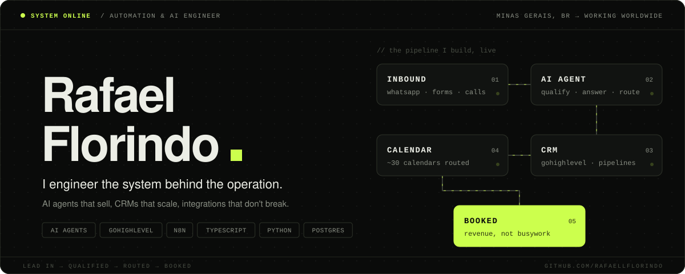

  

  
  
  

  

<h3 align="center">I don't automate clicks. I engineer the system behind the operation.</h3>

  Automation & AI Engineer from Brazil 🇧🇷 — building the technical layer behind revenue operations: 
  <b>AI agents</b> that qualify and book · <b>CRM architecture</b> that scales · <b>integrations</b> · <b>internal tools</b> · <b>multi-tenant SaaS</b>

  

## ⚡ What I build

| | |
| --- | --- |
| 🤖 **AI agents** | Agents that qualify leads, answer, route and book — with human handoff and guardrails, not just a prompt |
| 🧩 **CRM infrastructure** | GoHighLevel architecture, snapshots, white-label environments and pipelines that don't collapse at scale |
| 🔌 **Integrations** | APIs, webhooks and n8n workflows with retries, idempotency and partial-failure handling |
| 🛠️ **Product engineering** | TypeScript, Python, Postgres, workers and tests — internal tools and multi-tenant SaaS |

My work lives between two layers that are usually treated separately: **fast operational delivery** (GoHighLevel, n8n, webhooks, AI services) and **real product engineering** (typed code, databases, tests, production safeguards).

## 💼 Where I work

| Company | Role | What I do |
| --- | --- | --- |
| **High Ticket Club** | GoHighLevel & Automation Specialist | Build automations and run the daily *Office Hours*, supporting members live |
| **Valente AI** | Implementer | Ship client systems, white-label environments, onboarding automation and dashboards |
| **Independent** | Builder | My own products, from idea to production |

## 🔬 Research: generative AI × software engineering

Computer Science at **Univértix** (final stretch). My thesis re-analyzes data from a controlled experiment comparing conventional development with GitHub Copilot — presented as a poster at **FAVE 2026**.

| Metric | Conventional | Copilot-assisted |
| --- | ---: | ---: |
| Completed observations | 35 | 35 |
| Mean completion time | 160.89 min | **71.17 min** |
| Difference | | **55.8% faster** · `p = 0.0017` |
| Functional tests | | +7 p.p. · *not statistically significant* |

> **Strong evidence of speed, not enough evidence of better quality.**
> That's why tests, security review and human judgment stay inside every AI-assisted workflow I run.

## 🧰 Stack

   
   
  

  
  
  
  
  

<b>🧠 How I work with AI — the multi-agent setup</b>

 

I use AI as an execution and review layer, not just a chat window.

| Stage | How |
| --- | --- |
| **Context** | An Obsidian second brain (1,000+ notes) that agents read and maintain: decisions, projects, patterns |
| **Orchestration** | One lead agent decomposes the work; specialists handle frontend, backend and tests in separate worktrees |
| **Implementation** | Claude Code and Codex CLI on real repositories, with atomic, reviewable commits |
| **Verification** | Cross-model audits, multi-angle code review, Playwright E2E, security sweeps, ephemeral Postgres rehearsals before migrations |
| **Learning loop** | What worked goes back into the brain instead of dying in chat history |

<b>📐 How I build — 5 principles</b>

 

1. **Production over demos.** Retries, partial data, API failures and human handoff are design inputs.
2. **Explicit business logic.** Tools change; the operational contract shouldn't disappear inside platform clicks.
3. **Reusable delivery.** Recurring work becomes snapshots, schemas, templates, agents and tested workflows.
4. **Cost and security are architecture.** Tenant isolation, API margins and privacy are product constraints.
5. **Proof over badges.** Tests, deployments and decisions carry more weight than a list of logos.

<picture>
  <source media="(prefers-color-scheme: dark)" srcset="https://raw.githubusercontent.com/RafaellFlorindo/RafaellFlorindo/output/snake-dark.svg">
  <source media="(prefers-color-scheme: light)" srcset="https://raw.githubusercontent.com/RafaellFlorindo/RafaellFlorindo/output/snake.svg">
  
</picture>

## Let's build the system behind the idea

Working on **AI agents, revenue automation, CRM infrastructure, internal tools or SaaS**? 
I'm open to projects and collaborations — let's talk.

 

