

  

  
  
  

  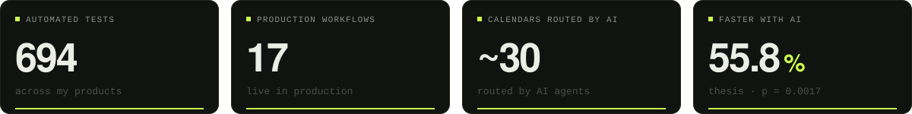

 

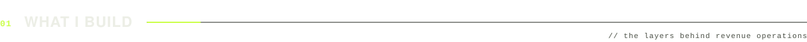

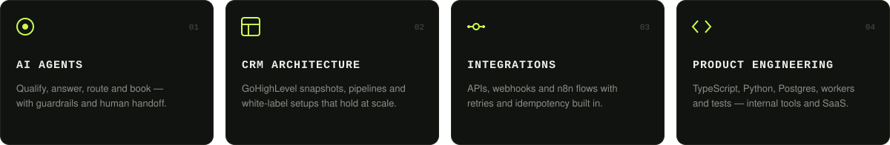

I work between two layers that are usually treated separately: **fast operational delivery** with GoHighLevel, n8n, webhooks and AI services, and **real product engineering** with TypeScript, Python, Postgres, workers and tests.

- **High Ticket Club** — GoHighLevel & automation specialist. I build the member operations and run the daily *Office Hours*, live.
- **Valente AI** — implementer. Client systems, white-label environments, onboarding automation and dashboards.
- **My own products** — the SaaS and tools below, from idea to production.

 

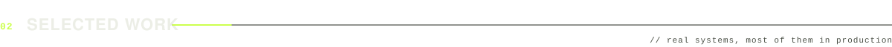

  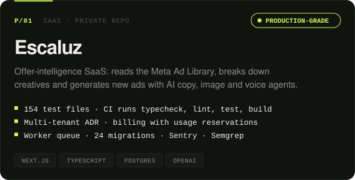
  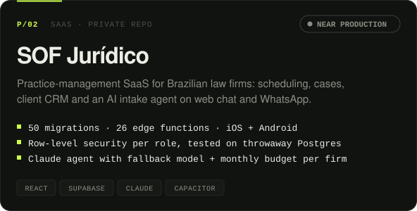

  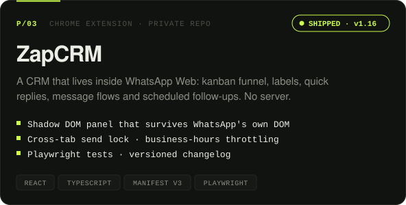
  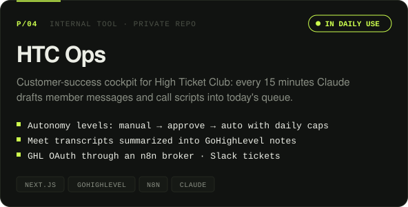

  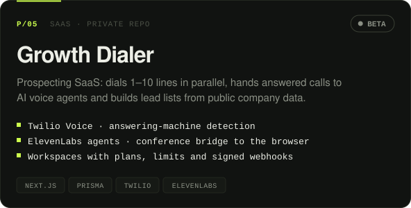
  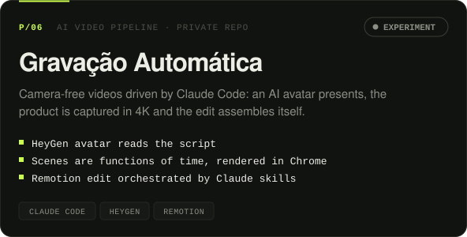

Most of these are client or commercial code, so the repositories are private — happy to walk through any of them on a call. Public samples: <a href="https://github.com/RafaellFlorindo/NotaZen"><b>NotaZen</b></a> (finance PWA for MEIs, integer-cent money, CSV-injection safe, Vitest) and <a href="https://github.com/RafaellFlorindo/Skills-Claude"><b>Skills-Claude</b></a> (my curated Claude Code skill library).

  

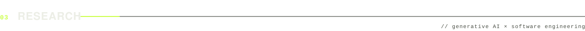

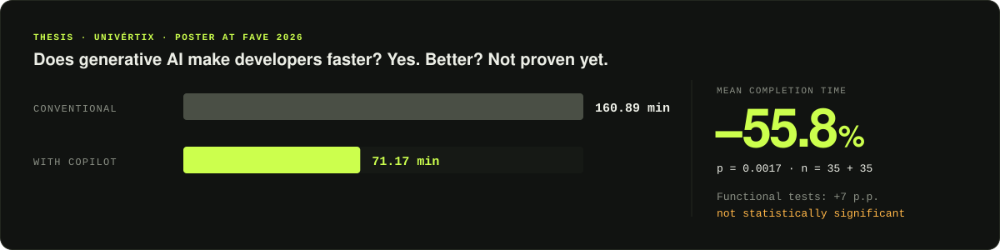

Computer Science at **Univértix** (final stretch). My thesis re-analyzes a controlled experiment comparing conventional development with GitHub Copilot, presented as a poster at **FAVE 2026**. The honest reading: **strong evidence of speed, not enough evidence of better quality** — which is exactly why tests, security review and human judgment stay inside every AI-assisted workflow I run.

 

  
  
  
  
  
  

  

 

| | How |
| --- | --- |
| **Context** | An Obsidian second brain that agents read and maintain: decisions, projects, patterns |
| **Orchestration** | A lead agent decomposes the work; specialists take frontend, backend and tests in separate worktrees |
| **Implementation** | Claude Code and Codex CLI on real repositories, with atomic, reviewable commits |
| **Verification** | Cross-model audits, Playwright E2E, security sweeps, ephemeral Postgres rehearsals before migrations |
| **Autonomy with brakes** | Agents act on levels — manual, approve, auto with caps — never unsupervised by default |

<b>Five rules I build by</b>

 

1. **Production over demos.** Retries, partial data, API failures and human handoff are design inputs.
2. **Explicit business logic.** Tools change; the operational contract shouldn't disappear inside platform clicks.
3. **Reusable delivery.** Recurring work becomes snapshots, schemas, templates, agents and tested workflows.
4. **Cost and security are architecture.** Tenant isolation, API budgets and privacy are product constraints.
5. **Proof over badges.** Tests, deployments and decisions weigh more than a list of logos.

 

<picture>
  <source media="(prefers-color-scheme: dark)" srcset="https://raw.githubusercontent.com/RafaellFlorindo/RafaellFlorindo/output/snake-dark.svg">
  <source media="(prefers-color-scheme: light)" srcset="https://raw.githubusercontent.com/RafaellFlorindo/RafaellFlorindo/output/snake.svg">
  
</picture>

### Have an operation that should run itself?

AI agents · revenue automation · CRM infrastructure · internal tools · SaaS

 

