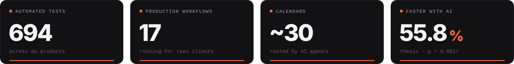
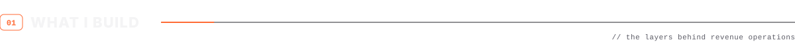
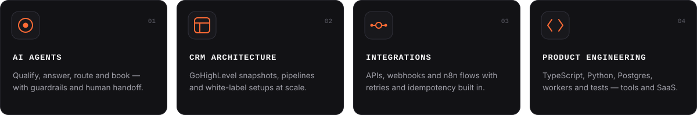
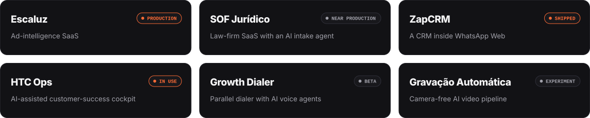
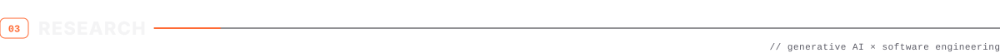
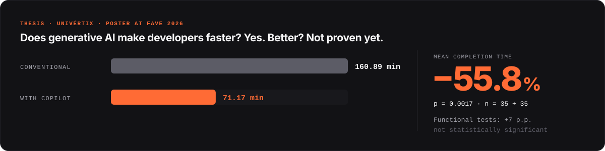
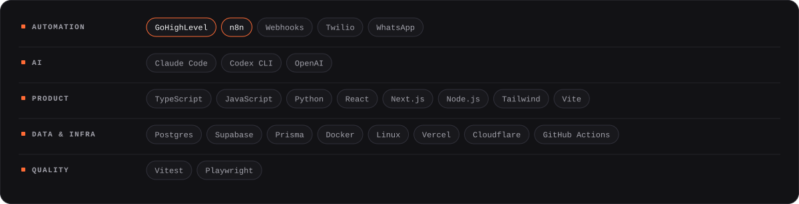
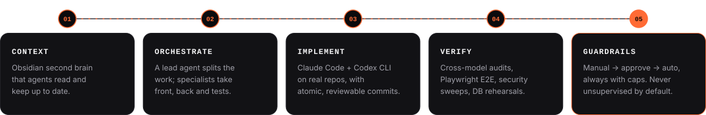

<picture>
  <source media="(prefers-color-scheme: light)" srcset="./assets/light/banner.svg">
  
</picture>

  <a href="https://www.linkedin.com/in/rafael-florindo"><picture><source media="(prefers-color-scheme: light)" srcset="./assets/light/btn-linkedin.svg"></picture></a>&nbsp;
  <a href="mailto:rafaelflorindodev@gmail.com"><picture><source media="(prefers-color-scheme: light)" srcset="./assets/light/btn-email.svg"></picture></a>&nbsp;
  <a href="https://github.com/RafaellFlorindo?tab=repositories"><picture><source media="(prefers-color-scheme: light)" srcset="./assets/light/btn-repos.svg"></picture></a>

<picture>
  <source media="(prefers-color-scheme: light)" srcset="./assets/light/metrics.svg">
  
</picture>

  

<picture>
  <source media="(prefers-color-scheme: light)" srcset="./assets/light/h-01.svg">
  
</picture>

<picture>
  <source media="(prefers-color-scheme: light)" srcset="./assets/light/capabilities.svg">
  
</picture>

I work across two layers that usually live apart: **fast operational delivery** — GoHighLevel, n8n, webhooks, AI services — and **real product engineering** — TypeScript, Python, Postgres, workers and tests. Most automation breaks at the seam between them. That seam is where I work.

| Where | What I do there |
| :-- | :-- |
| **High Ticket Club** | GoHighLevel & automation specialist. I build member operations and run the daily *Office Hours*, live. |
| **Valente AI** | Implementer. Client systems, white-label environments, onboarding automation and dashboards. |
| **My own products** | The SaaS and tools below, from idea to production. |

 

<picture>
  <source media="(prefers-color-scheme: light)" srcset="./assets/light/h-02.svg">
  
</picture>

<picture>
  <source media="(prefers-color-scheme: light)" srcset="./assets/light/work.svg">
  
</picture>

Most of this is private client and product code. Public samples → <a href="https://github.com/RafaellFlorindo/NotaZen"><b>NotaZen</b></a> · <a href="https://github.com/RafaellFlorindo/Skills-Claude"><b>Skills-Claude</b></a>

  

<picture>
  <source media="(prefers-color-scheme: light)" srcset="./assets/light/h-03.svg">
  
</picture>

<picture>
  <source media="(prefers-color-scheme: light)" srcset="./assets/light/research.svg">
  
</picture>

Computer Science at **Univértix**, final stretch. My thesis re-analyzes a controlled experiment comparing conventional development with GitHub Copilot, presented as a poster at **FAVE 2026**.

> **The honest reading:** strong evidence of speed, not enough evidence of better quality. That is exactly why tests, security review and human judgment stay inside every AI-assisted workflow I run.

 

<picture>
  <source media="(prefers-color-scheme: light)" srcset="./assets/light/h-04.svg">
  
</picture>

<picture>
  <source media="(prefers-color-scheme: light)" srcset="./assets/light/toolkit.svg">
  
</picture>

  

<picture>
  <source media="(prefers-color-scheme: light)" srcset="./assets/light/h-05.svg">
  
</picture>

<picture>
  <source media="(prefers-color-scheme: light)" srcset="./assets/light/workflow.svg">
  
</picture>

<b>Five rules I build by</b>

 

1. **Production over demos.** Retries, partial data, API failures and human handoff are design inputs, not edge cases.
2. **Explicit business logic.** Tools change; the operational contract shouldn't disappear inside platform clicks.
3. **Reusable delivery.** Recurring work becomes snapshots, schemas, templates, agents and tested workflows.
4. **Cost and security are architecture.** Tenant isolation, API budgets and privacy are product constraints.
5. **Proof over badges.** Tests, deployments and decisions weigh more than a list of logos.

 

<picture>
  <source media="(prefers-color-scheme: dark)" srcset="https://raw.githubusercontent.com/RafaellFlorindo/RafaellFlorindo/output/snake-dark.svg?v=3">
  <source media="(prefers-color-scheme: light)" srcset="https://raw.githubusercontent.com/RafaellFlorindo/RafaellFlorindo/output/snake.svg?v=3">
  
</picture>

### Have an operation that should run itself?

AI agents · revenue automation · CRM infrastructure · internal tools · SaaS

<a href="https://www.linkedin.com/in/rafael-florindo"><picture><source media="(prefers-color-scheme: light)" srcset="./assets/light/cta-linkedin.svg"></picture></a>&nbsp;
<a href="mailto:rafaelflorindodev@gmail.com"><picture><source media="(prefers-color-scheme: light)" srcset="./assets/light/cta-email.svg"></picture></a>

<picture>
  <source media="(prefers-color-scheme: light)" srcset="./assets/light/outro.svg">
  
</picture>
